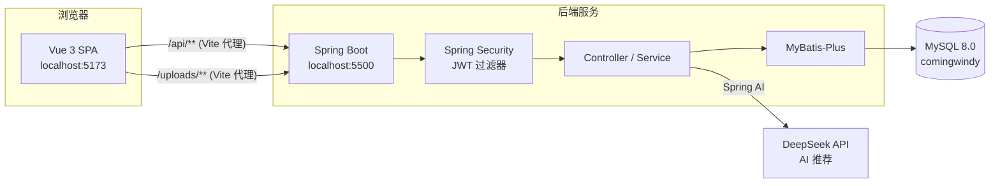

# 🥗 HealthyDiet · 健康饮食管理系统

<p align="left">
  
  
  
  
  
  
  
</p>

一个基于 **Vue 3 + Spring Boot** 的前后端分离健康饮食管理系统。围绕"食材 → 食谱 → 个性化推荐 → 饮食清单 → 健康档案"的完整链路，提供**管理员后台**和**普通用户端**两套界面，并接入大语言模型（DeepSeek）实现 AI 智能推荐。

> 本项目为个人学习实践作品，代码结构清晰、注释详尽，适合作为 **Vue3 + Spring Boot 前后端分离** 的入门参考项目。

---

## 📖 目录

- [功能特性](#-功能特性)
- [技术栈](#-技术栈)
- [系统架构](#-系统架构)
- [项目结构](#-项目结构)
- [快速开始](#-快速开始)
- [默认账号](#-默认账号)
- [API 接口一览](#-api-接口一览)
- [配置说明](#-配置说明)
- [常见问题](#-常见问题)
- [已知限制](#-已知限制)
- [后续计划](#-后续计划)
- [License](#-license)

---

## ✨ 功能特性

系统分为**管理员后台**（`/admin`）和**用户端**（`/home`）两套界面，根据登录账号的角色自动分流。

### 👨‍💼 管理端

| 模块 | 说明 |
| --- | --- |
| 数据看板 | 食材/食谱/今日推荐/注册用户统计，近 7 天推荐趋势折线图、食材分类分布饼图 |
| 用户管理 | 用户增删改查、分页与关键字搜索、角色分配、重置密码 |
| 食材分类 | 分类树管理（支持父子层级） |
| 食材信息 | 食材 CRUD，含热量、蛋白质、脂肪、碳水、维生素、矿物质等营养字段 |
| 食谱管理 | 食谱 CRUD，含适用人群、烹饪步骤、食材用量明细 |
| 每日推荐 | 基于推荐规则生成每日食谱推荐 |
| AI 推荐 | 调用大模型，根据用户健康档案生成个性化饮食建议 |
| 推荐记录 | 推荐历史查询与用户反馈 |
| 饮食清单 | 用户饮食计划管理 |
| 健康档案 | 用户健康信息（身高、体重、BMI、过敏原、饮食目标等） |
| 系统公告 | 公告发布与管理 |

### 👤 用户端

- **个人首页**：健康概览与快捷入口
- **食材浏览 / 食谱推荐**：按分类浏览食材与食谱详情
- **AI 推荐**：基于个人健康档案生成个性化饮食方案
- **健康档案**：维护个人身体数据与饮食偏好
- **饮食清单**：查看与管理自己的饮食计划，支持标记完成
- **推荐历史**：查看历史推荐记录

---

## 🛠 技术栈

### 前端

| 技术 | 版本 | 说明 |
| --- | --- | --- |
| Vue | 3.5 | 组合式 API（`<script setup>`） |
| Vite | 8.x | 构建工具与开发服务器 |
| Vue Router | 4.6 | 路由管理，history 模式 + 全局导航守卫 |
| Pinia | 4.x | 状态管理 |
| Element Plus | 2.14 | UI 组件库 |
| Axios | 1.20 | HTTP 请求，统一封装拦截器 |
| ECharts | 6.x | 数据可视化 |

### 后端

| 技术 | 版本 | 说明 |
| --- | --- | --- |
| Spring Boot | 4.1.1 | 基础框架（Java 17） |
| Spring Security | 7.1.1 | 认证授权，无状态 JWT 过滤器链 |
| MyBatis-Plus | 3.5.17 | ORM，分页插件 |
| Spring AI | 2.0.0 | 对接大模型（OpenAI 兼容协议） |
| JJWT | 0.12.5 | JWT 生成与校验 |
| MySQL | 8.0 | 数据库 |
| Lombok | 1.18 | 简化实体类 |

---

## 🏗 系统架构



**请求链路**：前端 Axios 以 `/api` 为 baseURL → Vite 开发代理转发到 `http://127.0.0.1:5500` → Spring Security 校验 JWT → Controller → Service → MyBatis-Plus → MySQL。

---

## 📁 项目结构

```
healthyboy/
├── backed/                          # 后端（Spring Boot）
│   ├── src/main/java/com/duanzanjiu/
│   │   ├── BackedApplication.java    # 启动类
│   │   ├── common/                   # 统一响应 Result / ResultCode
│   │   ├── config/                   # Security、JWT 过滤器、WebMvc、MyBatis-Plus
│   │   ├── controller/               # 11 个 REST 控制器
│   │   ├── service/                  # 业务逻辑
│   │   ├── mapper/                   # MyBatis-Plus Mapper
│   │   ├── entity/                   # 数据库实体
│   │   ├── DTO/                      # 请求/响应对象
│   │   ├── exception/                # 业务异常与全局异常处理
│   │   └── utils/                    # JwtUtils
│   ├── src/main/resources/
│   │   ├── application.yml.example   # 配置模板（提交到仓库）
│   │   └── application.yml           # 本地真实配置（已 gitignore）
│   ├── uploads/                      # 上传文件目录（仅保留演示图）
│   └── pom.xml
│
├── healthy_system/                  # 前端（Vue 3 + Vite）
│   ├── src/
│   │   ├── api/                      # 按模块封装的接口调用
│   │   ├── layouts/                  # MainLayout（管理端）/ UserLayout（用户端）
│   │   ├── views/                    # 页面组件
│   │   ├── router/index.js           # 路由表 + 登录/角色守卫
│   │   ├── stores/user.js            # Pinia 用户状态
│   │   ├── utils/request.js          # Axios 封装（token 注入、401 处理）
│   │   └── data/menuData.js          # 默认菜单（后端菜单为空时兜底）
│   ├── vite.config.js                # 开发代理配置
│   └── package.json
│
├── db/
│   ├── schema.sql                    # 建库建表脚本（17 张表）
│   └── seed.sql                      # 初始化数据（角色、菜单、演示食材/食谱）
│
├── .gitignore
├── .gitattributes
├── LICENSE
└── README.md
```

---

## 🚀 快速开始

### 环境要求

| 依赖 | 版本要求 |
| --- | --- |
| JDK | 17+ |
| Maven | 3.8+（或使用项目自带 `mvnw`） |
| Node.js | 18+（推荐 20/22） |
| MySQL | 8.0+ |

> ⚠️ **重要**：请将项目放在**纯英文、无空格**的路径下。路径含中文时，Java 启动可能出现 `找不到或无法加载主类` 的错误（classpath 解析问题）。

### 1️⃣ 初始化数据库

```bash
# 创建数据库与表结构（脚本内含 CREATE DATABASE comingwindy）
mysql -u root -p < db/schema.sql

# 导入初始化数据：角色、菜单、演示食材与食谱
mysql -u root -p < db/seed.sql
```

### 2️⃣ 启动后端

```bash
cd backed

# 复制配置模板，并填入你自己的数据库密码与大模型 API Key
copy src\main\resources\application.yml.example src\main\resources\application.yml

# 启动（项目自带 Maven Wrapper，无需本地安装 Maven）
mvnw.cmd spring-boot:run          # Windows
./mvnw spring-boot:run            # macOS / Linux
```

后端启动在 **http://localhost:5500**。

验证是否启动成功：

```bash
curl http://localhost:5500/api/auth/test
# 返回 test 即为正常
```

### 3️⃣ 启动前端

```bash
cd healthy_system
npm install
npm run dev
```

前端启动在 **http://localhost:5173**，浏览器打开即可。

### 4️⃣ 打包部署（可选）

```bash
# 前端打包，产物在 healthy_system/dist
cd healthy_system && npm run build

# 后端打包，产物在 backed/target/*.jar
cd backed && mvnw.cmd clean package
java -jar target/backed-0.0.1-SNAPSHOT.jar
```

---

## 🔑 默认账号

| 账号 | 密码 | 角色 | 说明 |
| --- | --- | --- | --- |
| `admin` | `1234567` | ADMIN | 管理员，登录后进入 `/admin/dashboard` |
| 其他用户 | `123456` | USER | 可在后台自行注册/创建 |

> 🔒 **首次登录后请立即修改默认密码**（个人中心 → 修改密码）。

除登录接口外，所有接口都需要在请求头携带 JWT：

```
Authorization: Bearer <token>
```

Token 有效期 24 小时（可在 `application.yml` 的 `jwt.expiration` 调整）。

---

## 📡 API 接口一览

统一响应格式：

```json
{
  "code": 200,
  "msg": "操作成功",
  "data": {}
}
```

### 认证

| 方法 | 路径 | 说明 | 是否需要 Token |
| --- | --- | --- | --- |
| GET | `/api/auth/test` | 连通性测试 | ❌ |
| POST | `/api/auth/login` | 登录，返回 token / userInfo / menus | ❌ |
| PUT | `/api/auth/profile` | 修改个人资料 | ✅ |
| POST | `/api/auth/change-password` | 修改密码 | ✅ |

### 用户管理

| 方法 | 路径 | 说明 |
| --- | --- | --- |
| GET | `/api/user/list` | 分页查询用户 |
| POST | `/api/user` | 新增用户 |
| PUT | `/api/user` | 修改用户 |
| DELETE | `/api/user/{id}` | 删除用户 |
| POST | `/api/user/reset-password/{id}` | 重置密码 |

### 食材 / 食谱

| 方法 | 路径 | 说明 |
| --- | --- | --- |
| GET | `/api/food/category/tree` | 分类树 |
| GET | `/api/food/category/list` | 分类列表 |
| POST / PUT / DELETE | `/api/food/category` `/api/food/category/{id}` | 分类增改删 |
| GET | `/api/food/info/list` | 食材分页列表 |
| GET | `/api/food/info/{id}` | 食材详情 |
| POST / PUT / DELETE | `/api/food/info` `/api/food/info/{id}` | 食材增改删 |
| GET | `/api/food/recipe/list` | 食谱分页列表 |
| GET | `/api/food/recipe/{id}` | 食谱详情（含食材明细） |
| POST / PUT / DELETE | `/api/food/recipe` `/api/food/recipe/{id}` | 食谱增改删 |

### 推荐 / 饮食计划

| 方法 | 路径 | 说明 |
| --- | --- | --- |
| GET | `/api/recommend/record/today` | 今日推荐 |
| POST | `/api/recommend/record/generate` | 按规则生成推荐 |
| POST | `/api/recommend/record/ai` | **AI 生成推荐** |
| POST | `/api/recommend/record/feedback` | 推荐反馈 |
| GET | `/api/recommend/record/list` | 推荐记录列表 |
| GET | `/api/recommend/record/my` | 我的推荐记录 |
| GET | `/api/diet-plan/list` | 饮食清单列表 |
| GET | `/api/diet-plan/my` | 我的饮食清单 |
| POST | `/api/diet-plan/from-recommend/{recordId}` | 由推荐生成清单 |
| POST | `/api/diet-plan/ai-generate` | **AI 生成饮食计划** |
| PUT | `/api/diet-plan/{id}/complete` | 标记清单完成 |

### 健康档案 / 公告 / 上传

| 方法 | 路径 | 说明 |
| --- | --- | --- |
| GET | `/api/health-profile/list` | 健康档案列表（管理端） |
| GET | `/api/health-profile/mine` | 我的健康档案 |
| POST | `/api/health-profile/mine` | 保存我的健康档案 |
| GET | `/api/notice/list` | 公告列表 |
| GET | `/api/notice/active` | 生效中的公告 |
| GET | `/api/notice/{id}` | 公告详情 |
| POST / PUT / DELETE | `/api/notice` `/api/notice/{id}` | 公告增改删 |
| POST | `/api/common/upload` | 文件上传，返回 `/uploads/xxx.png` |
| GET | `/api/dashboard/admin/stats` | 管理端统计 |
| GET | `/api/dashboard/admin/charts` | 图表数据 |
| GET | `/api/dashboard/user/overview` | 用户端概览 |

---

## ⚙️ 配置说明

### 后端配置

复制 `backed/src/main/resources/application.yml.example` 为 `application.yml` 后修改：

```yaml
server:
  port: 5500

spring:
  datasource:
    url: jdbc:mysql://localhost:3306/comingwindy?useSSL=false&serverTimezone=UTC
    username: root
    password: 你的数据库密码
    driver-class-name: com.mysql.cj.jdbc.Driver

  ai:
    openai:
      # 推荐使用环境变量，避免密钥写进文件
      api-key: ${DEEPSEEK_API_KEY:sk-你的密钥}
      base-url: https://api.deepseek.com
      chat:
        completions-path: /v1/chat/completions
        options:
          model: deepseek-chat        # 填你账号可用的模型名
          tool-calling:
            enabled: true

jwt:
  secret: 你的JWT密钥（HS512 建议 64 字节以上）
  expiration: 86400000                 # 24 小时（毫秒）

file:
  path-path: ./uploads/                # 上传目录（相对于后端启动目录）
```

> 🔐 `application.yml` 已在 `.gitignore` 中，不会被提交。仓库里只保留不含真实密钥的 `application.yml.example`。

### 前端代理

开发环境下，前端通过 Vite 代理访问后端（`healthy_system/vite.config.js`）：

```js
server: {
  proxy: {
    '/api':     { target: 'http://127.0.0.1:5500', changeOrigin: true },
    '/uploads': { target: 'http://127.0.0.1:5500', changeOrigin: true }
  }
}
```

后端未开启 CORS，因此**开发时请通过 Vite 代理访问**，不要绕过代理直连。

---

## ❓ 常见问题

<details>
<summary><b>1. 前端页面打开是 404「页面走丢了」</b></summary>

- 确认访问的是前端端口 **5173**，不是后端端口 5500（后端没有页面，直接访问根路径必然报错）。
- 确认已登录。未登录访问受保护路由会被守卫重定向到 `/login`。
- 若某个菜单点进去 404，通常是**路由重名**导致：Vue Router 4 注册同名路由时会移除先注册的那条。请确保每个路由的 `name` 唯一。
</details>

<details>
<summary><b>2. 后端启动报「找不到或无法加载主类」</b></summary>

项目路径（或 Maven 本地仓库路径）含**中文、空格或特殊字符**时，classpath 解析会失败。请把项目移到纯英文路径（如 `D:\projects\healthyboy`）后重新编译运行。
</details>

<details>
<summary><b>3. 接口 401 / 403</b></summary>

- `401`：token 无效或已过期，前端会自动清除登录态并跳回登录页。
- `403`：未携带 token 访问受保护接口（Spring Security 默认行为）。除 `/api/auth/login`、`/api/auth/test`、`/api/common/upload`、`/uploads/**` 外都需要 token。
</details>

<details>
<summary><b>4. 图片全部裂开（/uploads/xxx.png 404）</b></summary>

上传目录是**相对路径** `./uploads/`，相对于后端进程的启动目录。请确保：

1. 后端从 `backed/` 目录启动（而不是仓库根目录）；
2. `db/seed.sql` 中的演示图已经随仓库一起存在 `backed/uploads/` 下。
</details>

<details>
<summary><b>5. AI 推荐报错</b></summary>

- 检查 `application.yml` 中的 `api-key` 是否有效、是否已充值；
- 检查 `model` 是否为账号可用的模型名（如 `deepseek-chat`）；
- 首次调用大模型可能耗时 5~30 秒，前端 axios 超时已放宽到 60 秒。
</details>

<details>
<summary><b>6. 前端改了路由/配置但页面没变化</b></summary>

Vite 的 HMR 在开发服务器重启后可能断开连接，导致旧标签页仍运行旧代码。请按 `Ctrl + Shift + R` 硬刷新，或关闭标签页重新打开。
</details>

---

## ⚠️ 已知限制

本项目为学习实践作品，以下部分有意保持简单，生产环境需进一步完善：

- **密码为明文存储**：登录时直接比对数据库字段，未使用 BCrypt 等哈希算法；
- **没有引入 Redis**：JWT 无状态校验，未实现主动登出/黑名单；
- **缺少接口级权限校验**：仅区分"是否登录"，未细化到"哪些接口仅管理员可用"；
- **AI 推荐结果未做严格的 JSON Schema 校验**，极端情况下可能出现格式异常；
- **数据库中存在预留表**：`recommend_rule`、`sys_log`、`sys_backup` 已建表但尚未在代码中使用。

## 🗺 后续计划

- [ ] 引入 BCrypt 加密用户密码
- [ ] 增加接口级角色权限（`@PreAuthorize`）
- [ ] 接入 Redis 实现 token 黑名单与登出
- [ ] 推荐规则引擎可视化配置
- [ ] 补充单元测试与接口测试
- [ ] 支持 Docker Compose 一键启动

## 🤝 贡献

欢迎提交 Issue 与 Pull Request。提交前请确保：

1. 代码能正常编译运行（前端 `npm run dev`、后端 `mvnw spring-boot:run`）；
2. 不要提交任何密钥、数据库密码等敏感信息；
3. 遵循项目现有代码风格与目录结构。

## 📄 License

本项目基于 [MIT License](LICENSE) 开源，可自由用于学习与二次开发。

---

<p align="center">如果这个项目对你有帮助，欢迎点个 ⭐ Star 支持一下！</p>
